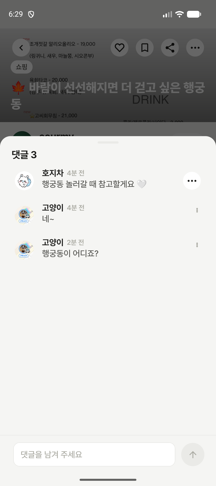
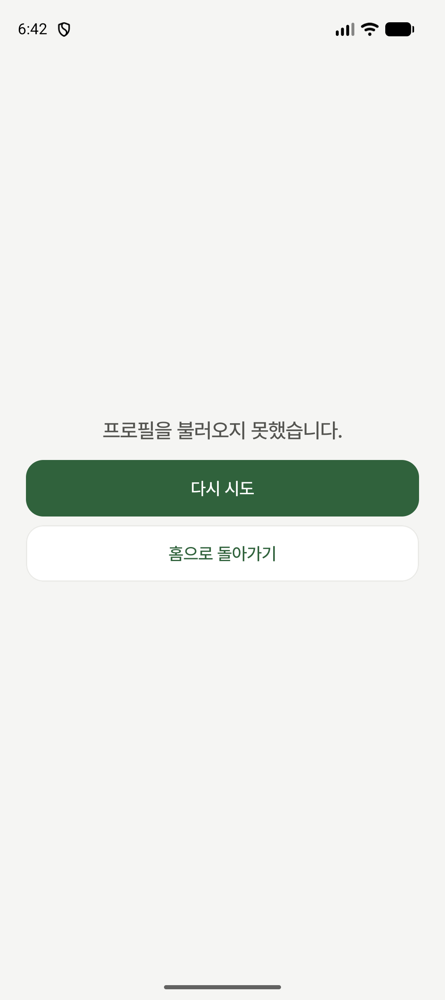

# 댓글 작성자 프로필 연동

- 브랜치: `fix/SCRUM-709-comment-author-profile`
- 작성자 ID/`나` 대신 서버 `authorNickname`을 표시하고 `authorProfileImageUrl`을 40dp 원형 이미지에 연결한다. 누락/null은 `알 수 없는 사용자`와 기본 사람 아이콘이다. 긴 닉네임은 한 줄 말줄임으로 날짜를 보호한다.
- 프로필 이미지는 1.5dp 흰색(`bgDefaultLevel1`) 원형 테두리와 2dp 그림자로 배경에서 분리한다.
- 본인/타인 더보기 버튼은 모두 48dp 터치 영역, 34dp 원형 배경(`bgDefaultLevel1`), 22dp 가로 점 3개(`contentDefaultLevel0`)로 통일한다. 본인 메뉴는 수정·삭제, 타인 메뉴는 신고하기를 유지한다.
- 이미지 버튼은 48dp다. 내 댓글은 시트를 닫고 마이페이지로 이동한다. 타인 댓글은 `authorId > 0`인 경우 시트를 닫고 기존 타인 프로필 라우트로 이동한다. ID가 없거나 유효하지 않은 타인 이미지는 비활성이다.
- 작성·수정 요청은 기존 content 계약을 유지하며 프로필 정보는 조회 응답에서만 읽는다.

## 프로필 조회 인자와 실검증

사용자 지정에 따라 댓글 `authorId.toString()`을 기존 공개 프로필 경로의 `handle` 인자로 전달한다. 별도 authorHandle 필드를 요구하지 않는다. 본인은 기존 마이페이지로 이동하고, 타인은 authorId > 0일 때 시트를 닫고 공개 프로필로 이동한다. 누락 ID는 0으로 매핑해 타인 이동을 비활성화한다.

2026-11-03 코스 511의 호지차(authorId=19) 이미지를 눌러 프로필 화면 진입을 확인했으나 조회 오류 화면이 표시됐다. 같은 시점 GET `/service/v1/mypage/19`는 HTTP 404, code=4042, `사용자를 찾을 수 없습니다: handle=19`를 반환했다. 따라서 클릭 경로는 연결됐지만 해당 사용자 프로필 데이터 표시까지 성공한 상태는 아니다. 백엔드 변경·배포는 포함하지 않는다.

## 검증

- `:course:data:testDebugUnitTest`: 85건 통과(댓글 작성자 정보·ID 보존 및 누락/null 매핑 포함).
- `:course:presentation:testDebugUnitTest`: 21건 통과.
- `:app:assembleDebug`, `:app:lintDebug`, `:course:presentation:detekt`, `:course:data:detekt`, `:course:entity:detekt`: 통과.
- 독립 리뷰에서 발견한 긴 닉네임 overflow를 Ellipsis로 보완했다.
- 2026-11-03 코스 511의 실제 댓글 3개에서 `호지차`, `고양이` 닉네임과 서버 프로필 이미지 표시를 에뮬레이터에서 확인했다. 임시 데이터 주입 없이 실제 API 응답을 사용했다. 개발 APK versionCode=999999.
- 최종 authorId 연결 후 data/presentation 테스트, APK, app lint, 관련 detekt 통과. 타인 이미지 클릭은 프로필 오류 화면까지 확인했으며 정상 데이터 표시는 미완료다. 본인 클릭 왕복은 미검증이다.

## 실제 화면 — 2026-11-03

| 코스 511 · 실제 댓글 목록 | 타인 프로필 클릭 · 조회 오류 |
| --- | --- |
|  |  |
