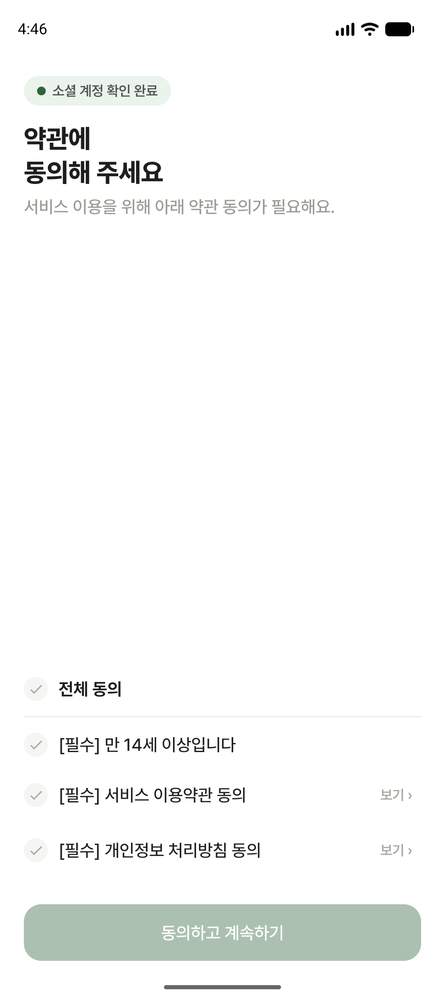
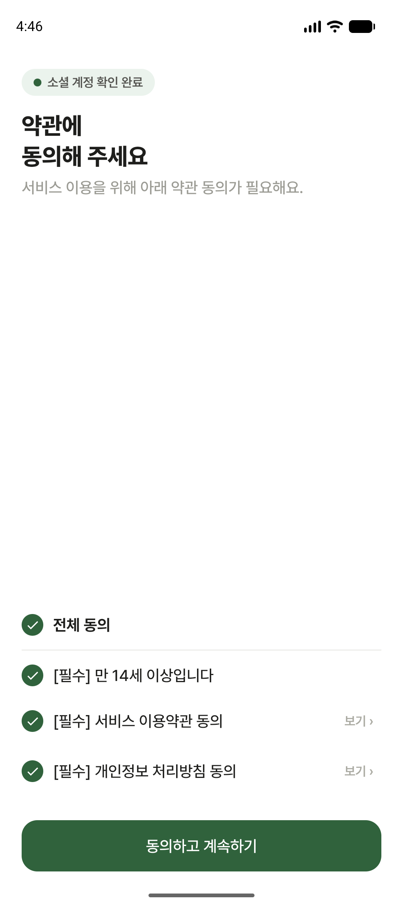

# 가입 약관·로그인 복귀 확인

촬영일: 2026-11-07 (KST). Android 에뮬레이터, debug, versionCode 2000000000.

| 상태 | 확인 자료 |
|---|---|
| 필수 항목 미체크, 계속하기 비활성 |  |
| 필수 3항목 전체 체크, 계속하기 활성 |  |
| 비로그인 코스 상세 → 로그인 → 동일 상세 복귀 | [실제 네이버 로그인 영상](login-return.mp4) |

영상은 courseId=169의 장소 목록을 펼치고 스크롤한 뒤 **코스 복제** 버튼으로 로그인 안내에 진입한 경우다. 네이버 기존 회원 인증 완료 후 동일 코스·스크롤·펼침 상태로 복귀했다. 복제 작업 자체를 자동 재실행하지 않는다. 앞뒤 대기만 잘랐으며 인증 결과를 모킹하지 않았다. 계정 입력 화면은 나오지 않았다.

로그인 전후 UI hierarchy 비교: `접기` bounds `[896,781][954,821]`, `토속촌 삼계탕` bounds `[153,900][416,959]` 동일. 로그의 `login ok` 다음 화면은 `/course/detail`이었다.

약관 캡처는 화면 확인을 위한 `/login/terms` 직접 진입이다. 실제 신규 계정을 생성한 증거는 아니다. 신규 가입 스택 복귀와 최종 동의 guard는 단위 테스트로 검증했다. 기존 회원은 약관 화면을 다시 거치지 않는다.

홈 지역별 둘러보기 숨김은 사용자 요청에 따라 별도 캡처하지 않았다.

서버 가입 API에 약관 동의 여부·버전·시각 필드가 없어 이 변경은 앱의 가입 전 확인만 제공한다. 서버 동의 이력 저장은 미구현이다. 약관 URL은 사용자 제공 원문으로 연결하며 웹 조회 도구에서는 본문 접근에 실패했다.
