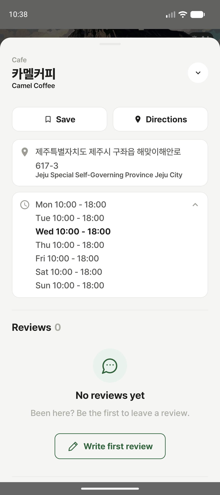

# 운영 시간 영어 표시 확인

2026-11-11 실제 에뮬레이터, 영어 선택 상태, 카멜커피 장소 상세. 설치 빌드 2000000020 / 1.3.999.

접힌 상태 Wed 10:00 - 18:00, 펼친 상태 Mon–Sun 10:00 - 18:00 표시를 확인했다. 운영 시간에는 한글 원문 병기가 없으며, 장소 이름·주소는 기존 이중 표기를 유지한다. 임의 휴무/자유 문장과 일본어는 이 캡처로 검증하지 않았다.

assembleDebug 성공. course:presentation:lintDebug는 PlaceSearchOverlay.kt:101의 LocalContextGetResourceValueCall 기존 작업 오류로 실패했다. 전체 검사 통과가 아니다. 현재 번역 작업본에 이미 반영된 openingHoursText 구현을 확인·빌드한 것이며 이번 확인에서 번역 코드를 덮어쓰지 않았다.

